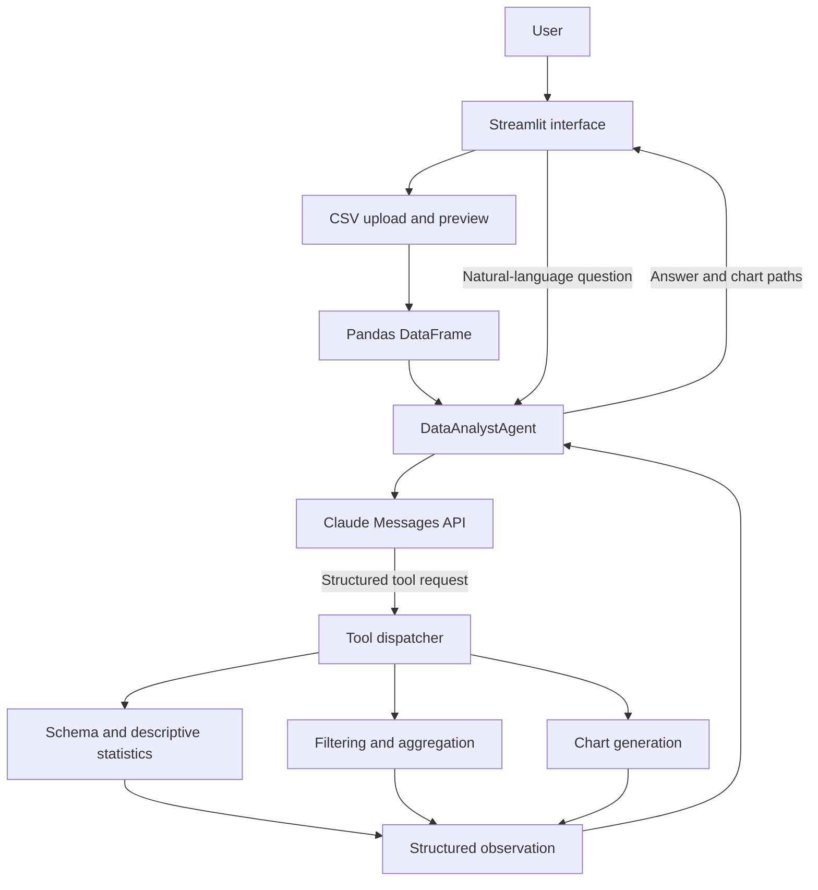

# InsightOps — AI Data Analyst Agent


**InsightOps** is an AI-powered data analysis application that lets users explore a CSV dataset by asking questions in natural language. Powered by the Anthropic Claude API, the agent selects from predefined analysis tools, executes real Python/pandas operations, observes the results, and produces a written answer with supporting charts.

The project uses a **chat-first Streamlit interface** as its sole intended user interface. Streamlit handles dataset upload and presentation, while the existing Python agent remains responsible for deciding which tools to call and interpreting their results.


## Contents

- [Problem](#problem)
- [How It Works](#how-it-works)
- [Features](#features)
- [Architecture](#architecture)
- [Technology Stack](#technology-stack)
- [Project Structure](#project-structure)
- [Setup on Windows](#setup-on-windows)
- [Configuration](#configuration)
- [Run the Application](#run-the-application)
- [Testing](#testing)
- [Safety and Reliability](#safety-and-reliability)
- [Limitations](#limitations)
- [Planned Improvements](#planned-improvements)

## Problem

Analyzing a spreadsheet often involves repeatedly inspecting columns, filtering records, computing grouped statistics, and creating plots. A general-purpose chatbot may explain how to do this, but its numerical answers are more useful when calculations are executed against the actual dataset.

InsightOps uses a tool-based approach: the LLM interprets the question and selects a supported operation, while Python performs the computation and returns a structured observation.

## How It Works

The application is designed around a bounded **decide → execute → observe → decide** loop:

1. **Upload a dataset:** The user uploads a CSV through the Streamlit interface.
2. **Inspect the data:** The application reads the CSV into a pandas DataFrame and makes the schema available to the agent.
3. **Ask a question:** The user enters a natural-language question in the chat interface.
4. **Choose a tool:** Claude requests one of the registered analysis tools using structured arguments.
5. **Execute the operation:** The Python application dispatches the request to the corresponding tool.
6. **Observe and continue:** The tool returns structured data or an error. Claude can use that observation to request another tool, subject to a configurable turn limit.
7. **Present the result:** Streamlit displays the agent's answer and, when available, generated charts. Tool-call details can be shown for transparency.

For example, a user could ask, *“Which region generated the most revenue, and how does revenue vary by product category?”* The agent can inspect the available columns, perform an aggregation, and create a chart if needed. The exact sequence depends on the model's tool choices rather than a hard-coded sequence for that question.

## Features

### Existing agent capabilities

- **Claude tool calling:** Uses the Anthropic Messages API with structured tool definitions.
- **Five analysis tools:** Schema inspection, descriptive statistics, row filtering, grouped aggregation, and chart creation.
- **Pandas-based analysis:** Calculations are performed on the loaded dataset.
- **Bounded agent loop:** A configurable maximum turn count limits repeated tool calls.
- **Structured tool observations:** Tool results and errors are returned to the agent.
- **Charts and reports:** Chart tools save image files; the existing report module supports Markdown report generation.
- **Automated tests:** Includes unit tests and an agent-loop test designed to use a mocked Claude client.

### Streamlit interface

- Chat-first interface for asking questions about an uploaded CSV.
- Dataset preview and basic information such as row and column counts.
- Analysis responses displayed alongside generated charts.
- Expandable tool-call details to help inspect how the agent reached an answer.
- Clear error messages for invalid files or failed analysis requests.


## Architecture



Streamlit is the only intended user interface. The agent and tool modules are kept separate from the presentation layer so the analysis logic can be tested independently.

## Technology Stack

| Area | Technology |
|---|---|
| Language | Python 3.12+ |
| LLM integration | Anthropic Claude Messages API |
| Data processing | pandas |
| Visualization | Matplotlib |
| User interface | Streamlit |
| Database connectivity | SQLAlchemy-supported sources, where configured |
| Configuration | `python-dotenv` |
| Testing | pytest, pytest-cov |


## Project Structure

```text
InsightOps/
├── app.py                     # Streamlit application entry point
├── requirements.txt
├── .env                       # Local secrets; do not commit
├── data/
│   └── sample_sales.csv
├── prompts/
│   └── system_prompt.txt
├── src/
│   └── agent/
│       ├── config.py
│       ├── data_loader.py
│       ├── tools.py
│       ├── core.py
│       └── report.py
├── tests/
│   ├── unit/
│   └── integration/
└── docs/
    ├── architecture.md
    ├── security.md
    ├── setup.md
    └── testing.md
```

This tree represents the intended project structure. Keep it synchronized with the actual repository as files are added, removed, or updated. Streamlit (`app.py`) is the sole intended user interface, while the Python agent modules handle the underlying analysis logic.

## Setup on Windows

### Prerequisites

- Python 3.12 or later
- Git
- An Anthropic API key for live analysis

### 1. Open the project

Open the repository folder in VS Code and open a PowerShell terminal in the project root.

### 2. Create and activate a virtual environment

```powershell
py -3.12 -m venv .venv
.\.venv\Scripts\Activate.ps1
```

If the virtual environment already exists, activate it rather than recreating it.

### 3. Install dependencies

```powershell
python -m pip install --upgrade pip
pip install -r requirements.txt
pip install streamlit
```

Once Streamlit integration is working, add the tested Streamlit version to `requirements.txt` so the environment can be recreated consistently.

### 4. Configure the API key

Create a `.env` file in the project root:

```env
ANTHROPIC_API_KEY=your_api_key_here
```

Never commit `.env` or publish your API key. Use a placeholder value in any example environment file.

## Configuration

The agent's configuration is defined in `src/agent/config.py`. Common environment variables used by the project include:

| Variable | Purpose |
|---|---|
| `ANTHROPIC_API_KEY` | Authenticates requests to the Anthropic API |
| `DATABASE_URL` | Optional database connection string |
| `OUTPUT_DIR` | Output location for reports and charts |
| `AGENT_MAX_TURNS` | Maximum number of turns in the tool-calling loop |
| `MAX_ROWS` | Limit on the number of rows loaded |

Check `src/agent/config.py` for the exact variable names, defaults, and validation rules in the current checkout.

## Run the Application

From the project root, with the virtual environment activated:

```powershell
streamlit run app.py
```

Streamlit will start a local development server and provide a local URL to open in your browser.

The intended workflow is to upload a CSV, preview the dataset, enter a question in the chat input, and view the agent's answer and any generated charts. This workflow will be available once `app.py` and the Streamlit-to-agent integration have been implemented.

## Testing

Run the tests from the project root:

```powershell
pytest tests/ -v
```

For coverage details:

```powershell
pytest tests/ -v --cov=src/agent --cov-report=term-missing
```

Run these commands in your own environment and report the actual result. Do not claim a test count or passing status unless it has been confirmed against the current checkout.

## Safety and Reliability

- The LLM is given registered tools rather than an interface for executing arbitrary generated Python code.
- The agent loop has a configurable turn limit.
- Tool functions return structured results and errors.
- The project includes input checks and row limits documented in the existing implementation.

These controls reduce risk but do not make the application a formally verified security sandbox. Review the filtering logic before using untrusted inputs or sensitive datasets. Do not upload confidential data to an external LLM API unless you are authorized to do so.

## Limitations

- Showing earlier messages in the UI does not automatically give the agent conversational memory; each analysis request is currently independent unless memory is implemented separately.
- CSV data is processed in memory and may be unsuitable for very large datasets.
- Analysis is limited to the operations supported by the registered tools.
- The model can misunderstand a question or explain a result incorrectly, so important findings should be checked against the returned data.

## Planned Improvements

- Display generated charts and an inspectable tool-call trace alongside the answer.
- Add evaluation questions with expected results to measure numerical correctness and tool-selection behavior.
- Improve error recovery for empty results, invalid columns, and failed tool calls.
- Add conversational memory for follow-up questions, with clear handling of dataset changes.
- Support downloadable analysis reports from the interface.

---
