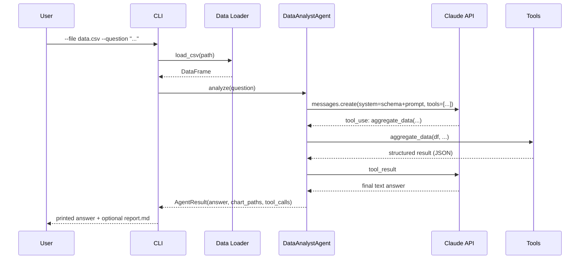

# Architecture

## Overview

The AI Data Analyst Agent has four layers, each independently testable:

1. **Data layer** (`data_loader.py`) — gets a CSV or SQL query result into a validated pandas DataFrame. Zero AI dependency; fully unit-testable without a network connection.
2. **Tool layer** (`tools.py`) — five narrow, structured functions operating on that DataFrame. This is the security boundary: the LLM can only call these five functions with JSON-schema-validated arguments, never arbitrary code.
3. **Agent layer** (`core.py`) — the bounded tool-calling loop against the Claude Messages API. Owns the conversation, dispatches tool calls, and enforces `AGENT_MAX_TURNS`.
4. **Presentation layer** (`report.py`, `cli.py`) — turns an `AgentResult` into a markdown report or CLI output.

## Why tools instead of free-form code execution

An earlier design considered letting the model write and execute arbitrary pandas/Python snippets (maximum flexibility). This was rejected for two reasons:

- **Security**: executing model-generated code against real business data (potentially containing PII) is a direct code-execution and data-exfiltration risk, especially under prompt injection (e.g., malicious content embedded in the dataset itself).
- **Reliability**: free-form code is harder to validate and more likely to silently produce a subtly wrong result (off-by-one groupings, wrong aggregation) than a fixed set of well-tested functions.

The five tools (`get_schema`, `describe_data`, `filter_data`, `aggregate_data`, `create_chart`) cover the large majority of real exploratory data analysis questions while keeping every operation auditable and unit-tested.

## Request flow

## Loop termination guarantee

`DataAnalystAgent.analyze()` runs a `for turns in range(1, max_turns + 1)` loop. Every iteration either returns (when `stop_reason != "tool_use"`) or executes exactly one round of tool calls. If the model never stops requesting tools, the loop still exits after `max_turns` iterations with a clear "reached maximum steps" message rather than looping indefinitely or crashing — verified by `test_agent_stops_at_max_turns`.
